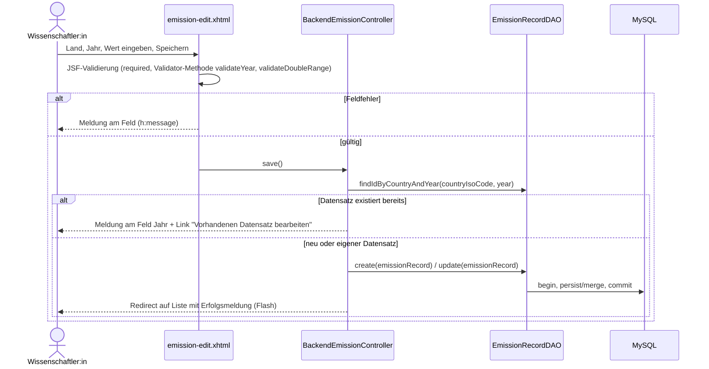

# Softwaretechnische Architektur

Schichten: **View** (Facelets/XHTML) → **Controller-Beans** (CDI, `@Named`) → **Services / DAOs** (`@ApplicationScoped`) → **JPA-Entitäten** → **MySQL**.

Laufzeitumgebung: Apache Tomcat 10.1 (Servlet 6.0). Die Anwendung bringt Jakarta Faces 4.0 (Mojarra), CDI 4.0 (Weld Servlet), JSON-P (Parsson) und Hibernate 6.6 als JPA-Provider in der WAR-Datei mit. Weld startet über einen `ServletContainerInitializer` und stellt CDI-Injection auch in Servlet-Filtern bereit (`AuthenticationFilter`).

- Pro Seite ein Controller. `BackendEmissionController` bedient Liste und Formular des Backends, jede Seite erhält eine eigene `@ViewScoped`-Instanz.
- Pro Entität ein DAO. Nur die DAOs enthalten Datenbankcode, die Entitäten sind reine Datenklassen.
- Genau eine `EntityManagerFactory` (in `EntityManagerProvider`). Pro Operation wird ein `EntityManager` erzeugt und im `finally`-Block geschlossen. Schreibende Operationen laufen in einer Transaktion (`begin` / `commit`, `rollback` im Fehlerfall).
- Die World-Bank-API wird nur beim Import angesprochen (`DataImportService` → `Data360Client`), nie bei einem Seitenaufruf.

## Code-Konventionen

- Englische, ausgeschriebene Bezeichner ohne Abkürzungen, z. B. `entityManager`, `transaction`, `countryIsoCode`, `co2Megatonnes`.
- Schleifen und Verzweigungen werden ausgeschrieben (`for`, `if`/`else`), keine Streams und keine `?:`-Operatoren. Auch die Views enthalten keine bedingten EL-Ausdrücke, die Texte und CSS-Klassen liefern die Beans (`getPageTitle()`, `getChangeStyleClass()`, `RecordSource.getBadgeStyleClass()`).
- Kommentare nur, wo der Code allein nicht verständlich ist.
- Ausnahme: Die Klassennamen `CountryDAO`, `EmissionRecordDAO` und `UserDAO` folgen dem im Kurs und im Briefing vorgegebenen Muster `<Entität>DAO`.
- Die Spaltennamen der Datenbank (`iso3`, `co2_mt`) folgen dem Datenmodell und werden über `@Column` auf die ausgeschriebenen Feldnamen abgebildet.

## UML-Klassendiagramm (alle Beans mit Scope und `@Inject`-Beziehungen)

```mermaid
classDiagram
    direction TB

    class PublicEmissionController {
        <<Named, ViewScoped>>
        -List~Country~ countries
        -String selectedCountryCode
        -Country selectedCountry
        -EmissionRecord latestRecord
        -List~EmissionRecord~ emissionHistory
        +onPageLoad()
        +loadSelectedCountry()
        +isNoDataAvailable() boolean
        +isHistoryAvailable() boolean
        +getPreviousRecord() EmissionRecord
        +getChangePercent() BigDecimal
        +getChangeStyleClass() String
    }
    class LoginController {
        <<Named, RequestScoped>>
        -String username
        -String password
        +login() String
    }
    class RegistrationController {
        <<Named, RequestScoped>>
        -String username
        -String displayName
        -String password
        -String passwordConfirmation
        -String registrationCode
        +isRegistrationEnabled() boolean
        +validateUsername(facesContext, component, value)
        +register() String
    }
    class UserSession {
        <<Named, SessionScoped>>
        -Long userId
        -String username
        -String displayName
        ~login(User)
        +logout() String
        +isLoggedIn() boolean
    }
    class BackendEmissionController {
        <<Named, ViewScoped>>
        -String filterCountryCode
        -List~EmissionRecord~ emissionRecords
        -Long recordId
        -EmissionRecord emissionRecord
        -String countryCode
        -Long duplicateRecordId
        +initializeList()
        +loadEmissionRecords()
        +runImport()
        +initializeForm() String
        +validateYear(facesContext, component, value)
        +save() String
        +getPageTitle() String
    }
    class AuthenticationFilter {
        <<WebFilter /backend/*>>
        +doFilter(servletRequest, servletResponse, filterChain)
    }

    class DataImportService {
        <<ApplicationScoped>>
        +importIfEmpty()
        +importFromApi() ImportResult
    }
    class ApplicationInitializer {
        <<ApplicationScoped>>
        ~onApplicationStart(@Observes @Initialized)
        +ensureInitialized()
        ~synchronizeDemoAccount()
    }
    class Data360Client {
        <<Hilfsklasse>>
        +fetchAll(indicator) List~Observation~
    }
    class PasswordHasher {
        <<Hilfsklasse, statisch>>
        +hash(password) String
        +verify(password, storedHash) boolean
    }
    class ApplicationSettings {
        <<Hilfsklasse, statisch>>
        +read(settingName, defaultValue) String
    }

    class EmissionRecordDAO {
        <<ApplicationScoped>>
        +findLatestByCountry(countryIsoCode) Optional
        +findByCountry(countryIsoCode) List
        +findAll(countryIsoCodeFilter) List
        +findById(id) Optional
        +findIdByCountryAndYear(countryIsoCode, year) Optional
        +create(emissionRecord)
        +update(emissionRecord) EmissionRecord
        +importValues(importedRecords) ImportCounts
        +count() long
    }
    class CountryDAO {
        <<ApplicationScoped>>
        +findAll() List
        +findByIsoCode(isoCode) Optional
        +saveAll(countries)
    }
    class UserDAO {
        <<ApplicationScoped>>
        +findByUsername(username) Optional
        +findById(id) Optional
        +create(user)
        +update(user) User
    }
    class EntityManagerProvider {
        <<ApplicationScoped>>
        -EntityManagerFactory entityManagerFactory
        +createEntityManager() EntityManager
    }

    class Country {
        <<Entity>>
        -String isoCode
        -String name
    }
    class EmissionRecord {
        <<Entity>>
        -Long id
        -Integer year
        -BigDecimal co2Megatonnes
        -RecordSource source
        -LocalDateTime changedAt
    }
    class User {
        <<Entity>>
        -Long id
        -String username
        -String passwordHash
        -String displayName
    }
    class RecordSource {
        <<enumeration>>
        WORLD_BANK
        RESEARCH
        +getLabel() String
        +getBadgeStyleClass() String
    }

    PublicEmissionController ..> CountryDAO : Inject
    PublicEmissionController ..> EmissionRecordDAO : Inject
    PublicEmissionController ..> ApplicationInitializer : Inject
    LoginController ..> ApplicationInitializer : Inject
    LoginController ..> UserDAO : Inject
    LoginController ..> UserSession : Inject
    LoginController ..> PasswordHasher : verwendet
    RegistrationController ..> UserDAO : Inject
    RegistrationController ..> UserSession : Inject
    RegistrationController ..> PasswordHasher : verwendet
    RegistrationController ..> ApplicationSettings : verwendet
    BackendEmissionController ..> EmissionRecordDAO : Inject
    BackendEmissionController ..> CountryDAO : Inject
    BackendEmissionController ..> UserDAO : Inject
    BackendEmissionController ..> UserSession : Inject
    BackendEmissionController ..> DataImportService : Inject
    AuthenticationFilter ..> UserSession : Inject
    ApplicationInitializer ..> UserDAO : Inject
    ApplicationInitializer ..> DataImportService : Inject
    ApplicationInitializer ..> PasswordHasher : verwendet
    ApplicationInitializer ..> ApplicationSettings : verwendet
    EntityManagerProvider ..> ApplicationSettings : verwendet
    DataImportService ..> CountryDAO : Inject
    DataImportService ..> EmissionRecordDAO : Inject
    DataImportService --> Data360Client : erzeugt
    EmissionRecordDAO ..> EntityManagerProvider : Inject
    CountryDAO ..> EntityManagerProvider : Inject
    UserDAO ..> EntityManagerProvider : Inject

    EmissionRecord "*" --> "1" Country : country
    EmissionRecord "*" --> "0..1" User : changedBy
    EmissionRecord --> RecordSource
```

## Beans

| Bean | Annotationen | Aufgabe |
|---|---|---|
| `PublicEmissionController` | `@Named @ViewScoped` | Länderauswahl, aktuellster Wert, Verlauf (US1) |
| `LoginController` | `@Named @RequestScoped` | Zugangsdaten prüfen, Session-ID erneuern, ins Backend weiterleiten |
| `RegistrationController` | `@Named @RequestScoped` | Selbstregistrierung mit Registrierungscode (`REGISTRATION_CODE`), Validator-Methode für eindeutige Benutzernamen, Passwort-Wiederholung prüfen, danach direkt anmelden |
| `UserSession` | `@Named @SessionScoped` | angemeldete:r Benutzer:in (nur ID, Name, Anzeigename), Logout |
| `BackendEmissionController` | `@Named @ViewScoped` | Liste mit Filter, Anlegen und Ändern mit Validator-Methode für das Jahr und Duplikatprüfung, manueller Import (US2) |
| `EmissionRecordDAO` | `@ApplicationScoped` | Datenbankzugriffe für Emissionsdaten |
| `CountryDAO` | `@ApplicationScoped` | Datenbankzugriffe für Länder |
| `UserDAO` | `@ApplicationScoped` | Datenbankzugriffe für Benutzerkonten |
| `EntityManagerProvider` | `@ApplicationScoped` | die eine `EntityManagerFactory`, Zugangsdaten aus Umgebungsvariablen |
| `DataImportService` | `@ApplicationScoped` | Import aus der Data360 API, wiederholbar, überschreibt nie `RESEARCH`-Werte |
| `ApplicationInitializer` | `@ApplicationScoped` | beim Start: Demo-Konto anlegen, Erstimport anstoßen, wenn die Datenbank leer ist |
| `AuthenticationFilter` | `@WebFilter("/backend/*")` | Zugriffsschutz für das Backend (Servlet-Filter mit injizierter `UserSession`) |

`Data360Client` (HTTP über `java.net.http.HttpClient`, JSON über `jakarta.json`), `PasswordHasher` (PBKDF2) und `ApplicationSettings` sind einfache Hilfsklassen ohne CDI-Scope. `ApplicationSettings` liest Einstellungen aus Umgebungsvariablen, System-Properties und der `.env`-Datei im Projektordner. `EntityManagerProvider` und `ApplicationInitializer` verwenden sie.

`ApplicationInitializer` gleicht beim Start das Demo-Konto mit `DEMO_PASSWORD` ab. Er legt das Konto an, falls es fehlt, und passt den Hash nur an, wenn das Passwort nicht mehr übereinstimmt.

Gegenüber dem Briefing sind `ApplicationInitializer` und `RegistrationController` dazugekommen. `RegistrationController` gehört zur Seite `register.xhtml` (pro Seite ein Controller) und ist wie das Login-Formular `@RequestScoped`. Er bündelt die Startlogik (Demo-Konto und Erstimport), damit `DataImportService` nur für den Import zuständig bleibt. `AuthFilter` aus dem Briefing heißt gemäß den Code-Konventionen `AuthenticationFilter`.

## Ablauf: Datensatz speichern (US2)

