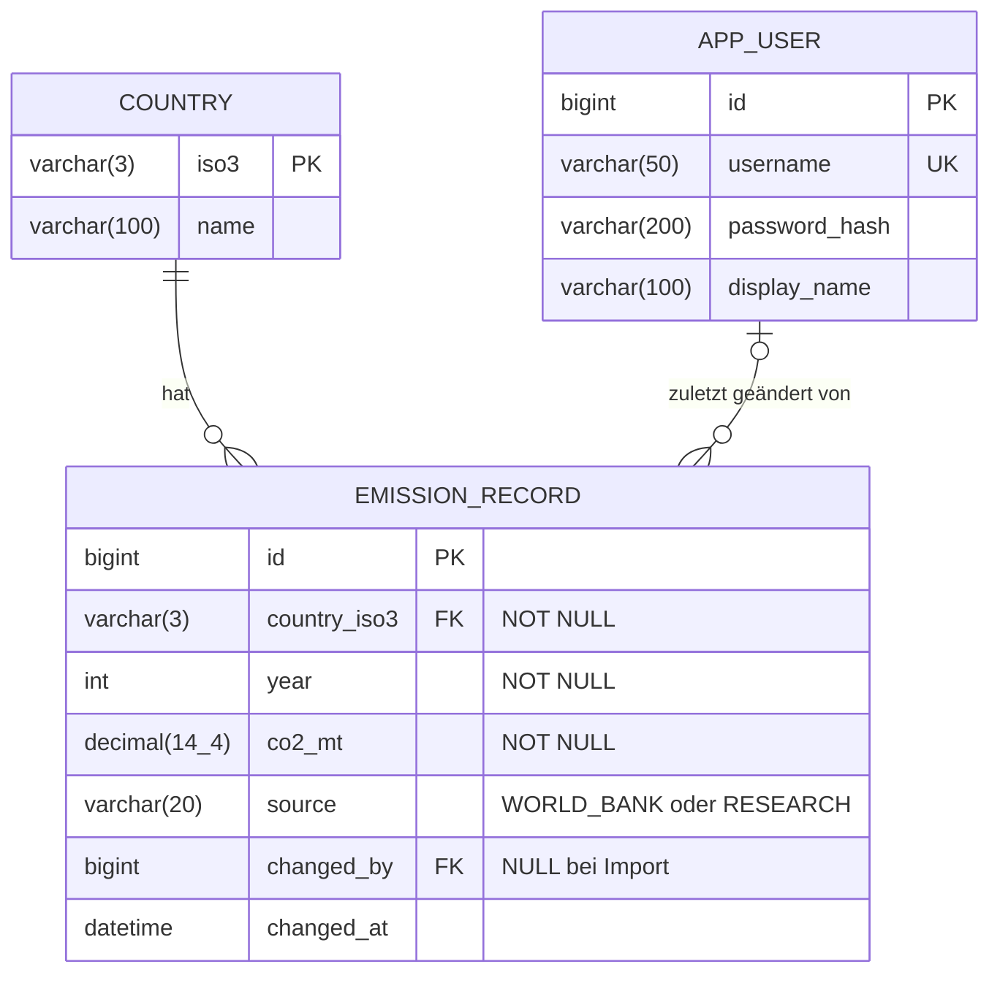

# Datenmodell

Datenbank: MySQL 8, Schema `likeherotozero`. Die Tabellen erzeugt Hibernate aus den JPA-Entitäten (`hibernate.hbm2ddl.auto=update`).



Eindeutigkeit in `emission_record`: `UNIQUE (country_iso3, year)` (`uk_emission_country_year`).

## Tabellen

### `country` (Entität `Country`)

| Spalte | Typ | Beschreibung |
|---|---|---|
| `iso3` | `varchar(3)`, PK | ISO-3166-1-alpha-3-Code, z. B. `DEU`. Fachlicher Schlüssel, weil die API damit arbeitet. Java-Feld: `isoCode`. |
| `name` | `varchar(100)`, NOT NULL | deutscher Ländername aus `Locale.getDisplayCountry(Locale.GERMAN)` |

### `emission_record` (Entität `EmissionRecord`)

| Spalte | Typ | Beschreibung |
|---|---|---|
| `id` | `bigint`, PK, auto increment | technischer Schlüssel (`@GeneratedValue(strategy = IDENTITY)`) |
| `country_iso3` | `varchar(3)`, FK → `country.iso3`, NOT NULL | `@ManyToOne` mit `@JoinColumn`, keine Assoziationstabelle |
| `year` | `int`, NOT NULL | Berichtsjahr |
| `co2_mt` | `decimal(14,4)`, NOT NULL | CO₂-Ausstoß in Millionen Tonnen CO₂-Äquivalent (`BigDecimal`, keine Rundungsfehler). Java-Feld: `co2Megatonnes`. |
| `source` | `varchar(20)`, NOT NULL | `WORLD_BANK` = importiert, `RESEARCH` = im Backend erfasst oder korrigiert (Enum `RecordSource`) |
| `changed_by` | `bigint`, FK → `app_user.id`, NULL | wer den Wert zuletzt im Backend geändert hat (leer bei importierten Werten) |
| `changed_at` | `datetime(6)` | Zeitpunkt des Imports bzw. der letzten Änderung |

### `app_user` (Entität `User`)

Der Tabellenname lautet `app_user`, weil `USER` in SQL ein reserviertes Wort ist.

| Spalte | Typ | Beschreibung |
|---|---|---|
| `id` | `bigint`, PK, auto increment | technischer Schlüssel |
| `username` | `varchar(50)`, UNIQUE, NOT NULL | Anmeldename |
| `password_hash` | `varchar(200)`, NOT NULL | `pbkdf2$<Iterationen>$<Salt>$<Hash>` (PBKDF2-HmacSHA256, 210.000 Iterationen, 16 Byte Salt). Klartext wird nie gespeichert. |
| `display_name` | `varchar(100)`, NOT NULL | Anzeigename in der Kopfzeile und in der Spalte „Geändert von“ |

## Wichtige Abfragen (`EmissionRecordDAO`)

```java
// US1: jüngster Datensatz eines Landes, immer aus der eigenen Datenbank berechnet
select emissionRecord from EmissionRecord emissionRecord join fetch emissionRecord.country
 where emissionRecord.country.isoCode = :countryIsoCode
 order by emissionRecord.year desc                         // setMaxResults(1)

// US2: Prüfung auf doppelten Eintrag vor dem Speichern
select emissionRecord.id from EmissionRecord emissionRecord
 where emissionRecord.country.isoCode = :countryIsoCode and emissionRecord.year = :year
```

Die Unique-Constraint sichert zusätzlich auf Datenbankebene ab, falls zwei Personen gleichzeitig denselben Datensatz anlegen.
