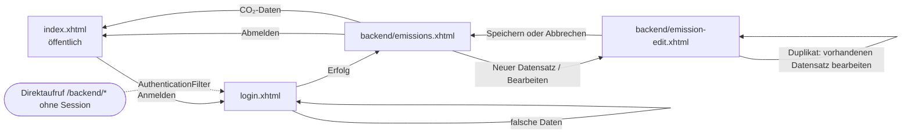

# Navigation zwischen den Seiten

| Übergang | Umsetzung |
|---|---|
| Startseite → Login | `h:link outcome="/login"` in der Kopfzeile (nur ohne Anmeldung sichtbar) |
| Login → Backend | `LoginController.login()` gibt `/backend/emissions?faces-redirect=true` zurück |
| Login bei falschen Daten | `login()` gibt `null` zurück, die Seite bleibt und zeigt die Fehlermeldung |
| Liste → Formular | `h:button outcome="emission-edit"` (neu) bzw. `h:link` mit `f:param name="id"` (bearbeiten) |
| Formular → Liste | `save()` gibt `emissions?faces-redirect=true&land=<ISO>` zurück; „Abbrechen“ ist ein `h:button` ohne Validierung |
| Abmelden | `UserSession.logout()` beendet die Session und leitet auf `/index` um |
| Schutz des Backends | `AuthenticationFilter` (`@WebFilter("/backend/*")`) leitet ohne angemeldete `UserSession` auf `login.xhtml` um, bei Ajax-Anfragen per `<partial-response><redirect/>` |
| Startseite mit Land | GET-Parameter `?land=DEU` über `f:viewParam` (verlinkbar) |
| Fehler | `error.xhtml` für HTTP 404/500, abgelaufene Views (`ViewExpiredException`) führen zur Startseite |

Alle Seiten verwenden das Template `WEB-INF/templates/layout.xhtml` mit Kopfzeile (Navigation), Inhaltsbereich und Fußzeile (Quellenangabe).
