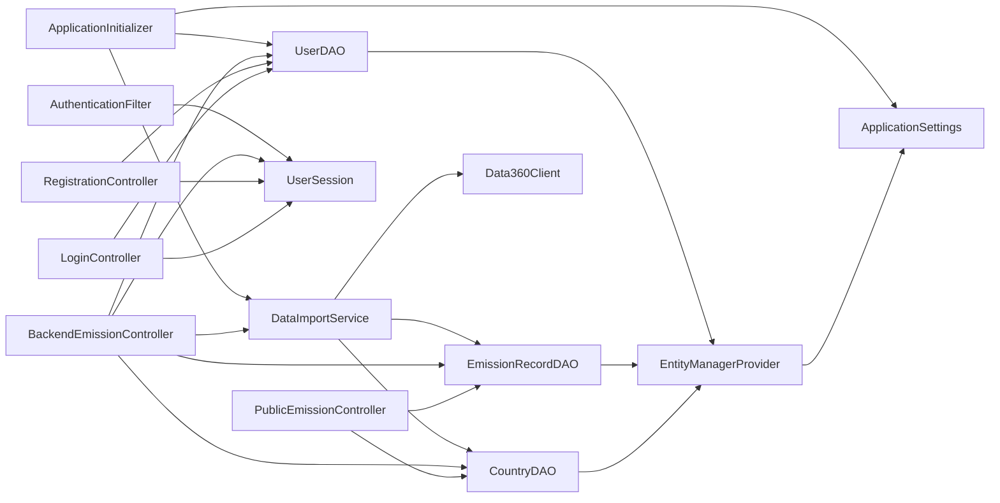
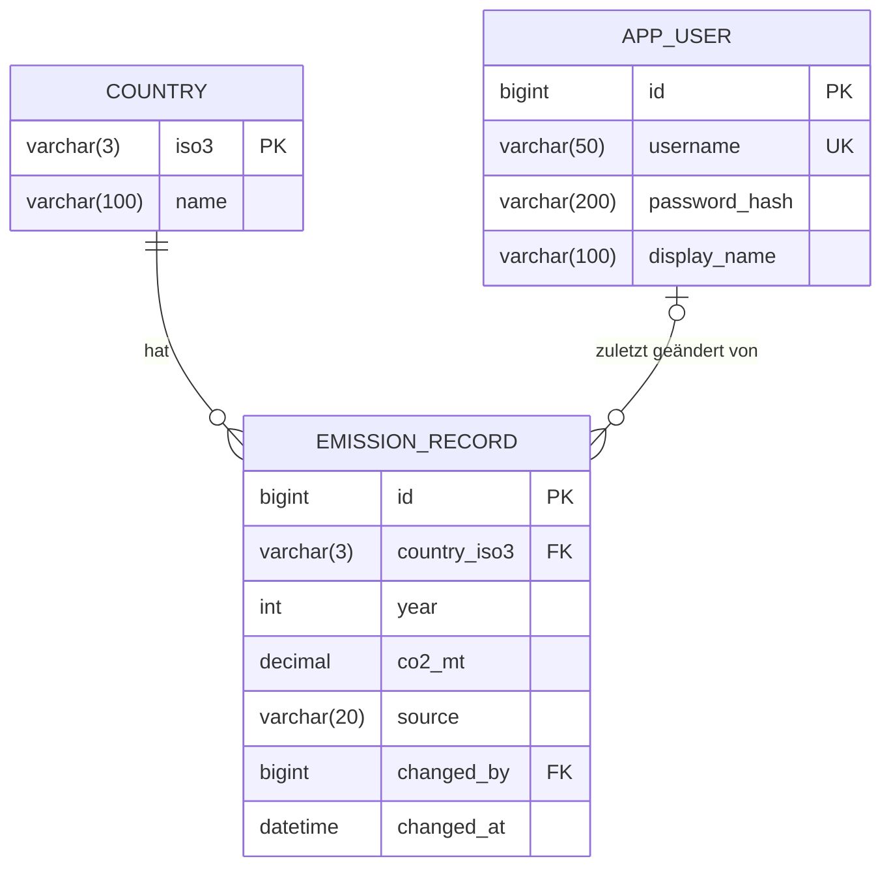
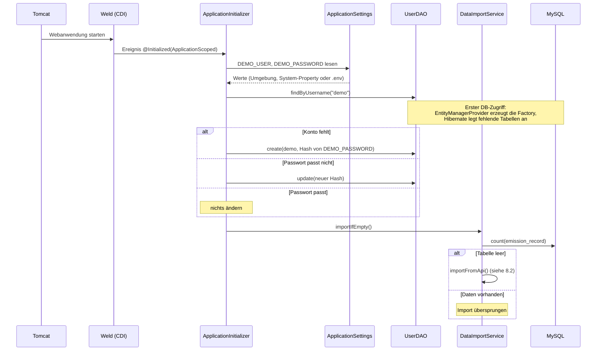
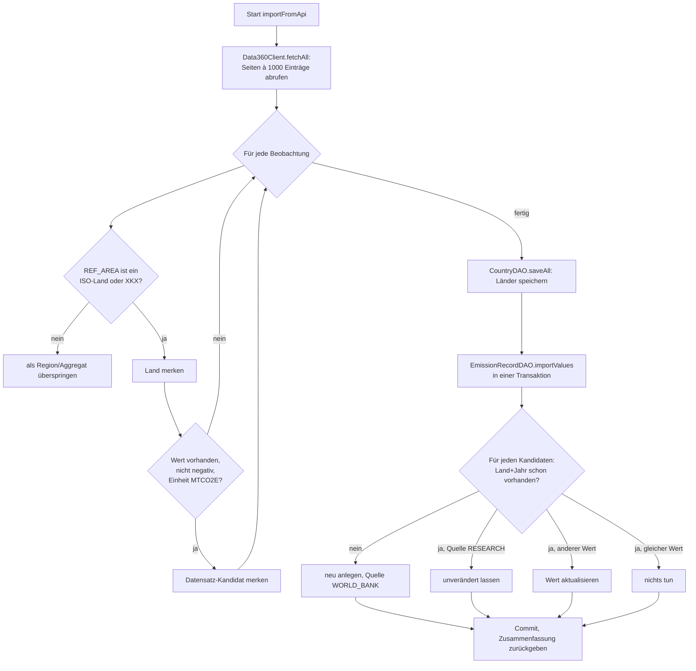
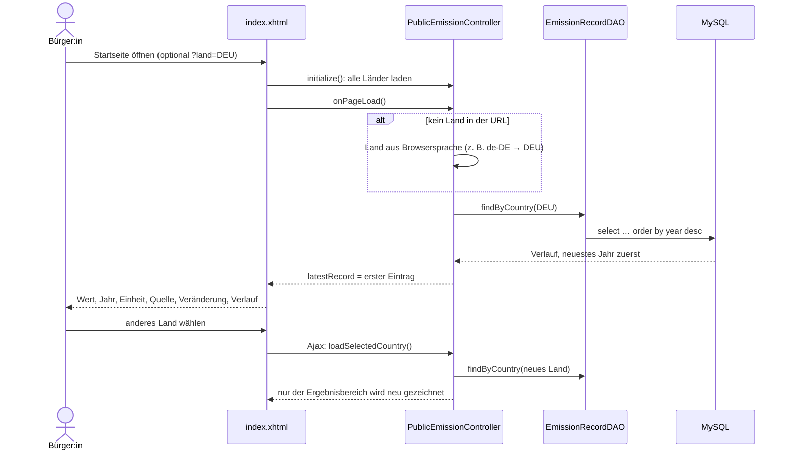
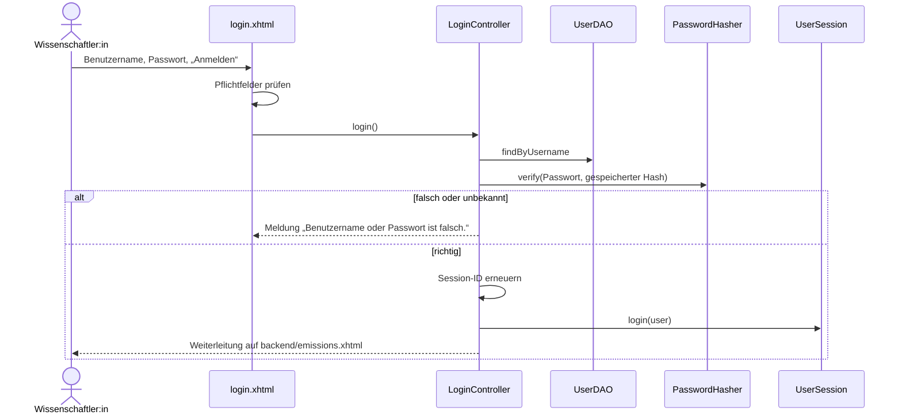
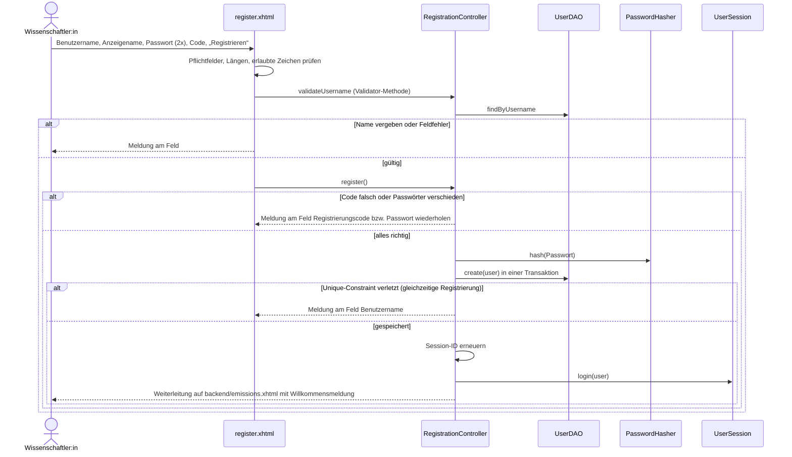
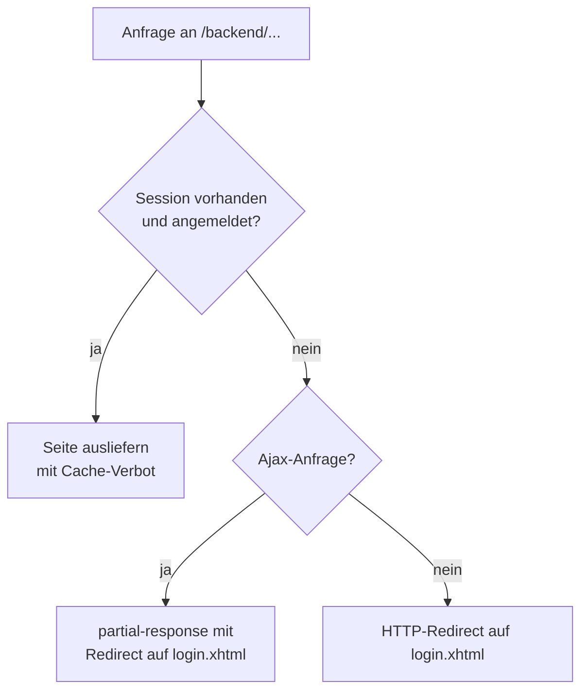
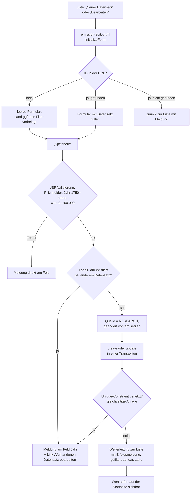
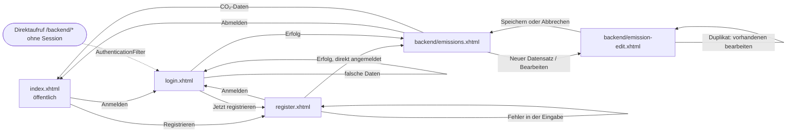

# Like Hero To Zero – Projektdokumentation

Diese Datei erklärt das gesamte Projekt: Zweck, Technik, Aufbau, alle Abläufe, die Daten und den Betrieb. Sie richtet sich an alle, die das Projekt verstehen, starten, weiterentwickeln oder im Fallstudienbericht beschreiben wollen.

## Inhalt

1. [Zweck und Anforderungen](#1-zweck-und-anforderungen)
2. [Technologie-Stack](#2-technologie-stack)
3. [Architektur im Überblick](#3-architektur-im-überblick)
4. [Projektstruktur](#4-projektstruktur)
5. [Die Komponenten im Einzelnen](#5-die-komponenten-im-einzelnen)
6. [Datenmodell](#6-datenmodell)
7. [Datenquelle: World Bank Data360 API](#7-datenquelle-world-bank-data360-api)
8. [Abläufe (Prozesse)](#8-abläufe-prozesse)
9. [Seiten und Navigation](#9-seiten-und-navigation)
10. [Validierung und Fehlermeldungen](#10-validierung-und-fehlermeldungen)
11. [Sicherheit](#11-sicherheit)
12. [Konfiguration](#12-konfiguration)
13. [Betrieb: Datenbank, Build, Start](#13-betrieb-datenbank-build-start)
14. [Tests](#14-tests)
15. [Code-Konventionen](#15-code-konventionen)
16. [Bewusste Entscheidungen und Abgrenzungen](#16-bewusste-entscheidungen-und-abgrenzungen)
17. [Fehlersuche](#17-fehlersuche)
18. [Glossar](#18-glossar)

---

## 1. Zweck und Anforderungen

„Like Hero To Zero“ ist ein Prototyp für eine Webanwendung zu weltweiten CO₂-Emissionen. Er entstand als Fallstudie im Kurs „Programmierung von industriellen Informationssystemen mit Java EE“ (IPWA02-01).

Die Anwendung hat zwei Bereiche:

| Bereich | Zugang | Zweck |
|---|---|---|
| Öffentlicher Bereich | ohne Login | Bürger:innen sehen den aktuellsten CO₂-Ausstoß eines Landes. |
| Backend (Datenpflege) | mit Login | Registrierte Wissenschaftler:innen erfassen neue Werte und korrigieren fehlerhafte. |

### User Stories

| Nr. | Priorität | Story | Umgesetzt |
|---|---|---|---|
| US1 | MUST | Als Bürger:in den aktuellsten CO₂-Ausstoß meines Landes nachlesen | ja |
| US2 | MUST | Als Wissenschaftler:in neue Daten hinterlegen und Daten korrigieren | ja |
| US3 | COULD | Änderungen müssen erst freigegeben werden | nein (bewusst nicht gebaut) |

### Akzeptanzkriterien und wo sie erfüllt werden

| Kriterium | Umsetzung |
|---|---|
| Startseite ohne Login erreichbar | `index.xhtml` liegt außerhalb von `/backend/`, der `AuthenticationFilter` greift dort nicht |
| Land aus einer Liste wählbar | `p:selectOneMenu` mit Suchfeld auf der Startseite |
| Land, Jahr, Wert und Einheit des jüngsten Jahres anzeigen | `PublicEmissionController` + `EmissionRecordDAO.findByCountry` (höchstes Jahr zuerst) |
| „Aktuellster Wert“ immer aus der eigenen Datenbank | Abfrage nach `year desc`, nicht nach dem API-Feld `LATEST_DATA` |
| Hinweis statt Fehlerseite, wenn kein Wert existiert | Karte „liegen leider noch keine CO₂-Werte vor“ (`isNoDataAvailable()`) |
| Optional: Verlauf der Vorjahre | Tabelle „Verlauf“ unter dem aktuellen Wert |
| Backend nur nach Login | `AuthenticationFilter` auf `/backend/*` |
| Falsche Zugangsdaten → Fehlermeldung | `LoginController.login()` |
| Neuen Datensatz anlegen, bestehenden ändern | `BackendEmissionController.save()` |
| Pflichtfelder, Wertebereiche, Duplikate abfangen | JSF-Validierung + Validator-Methode + Duplikatprüfung + Unique-Constraint |
| Daten überleben einen Neustart und sind sofort öffentlich | MySQL im Docker-Volume, Startseite liest bei jeder Auswahl neu aus der Datenbank |
| Logout beendet die Session | `UserSession.logout()` invalidiert die HTTP-Session |

---

## 2. Technologie-Stack

| Ebene | Technik | Version | Herkunft |
|---|---|---|---|
| Sprache | Java | 17 (läuft auch auf neueren JDKs, getestet mit 27) | JDK |
| Build | Maven, Packaging `war` | 3.9 | – |
| Server | Apache Tomcat | 10.1 (Servlet 6.0) | lokal installiert |
| Plattform | Jakarta EE 10, Namensraum `jakarta.*` | – | – |
| Views | Jakarta Faces 4.0 (Mojarra) mit Facelets (`.xhtml`) | 4.0.26 | in der WAR |
| Komponenten | PrimeFaces (Klassifier `jakarta`) | 15.0.18 | in der WAR |
| Beans | CDI 4.0 (Weld Servlet) | 5.1.7 | in der WAR |
| Persistenz | Jakarta Persistence 3.1 mit Hibernate | 6.6.58 | in der WAR |
| JSON | Jakarta JSON Processing (Parsson) | 2.1 / 1.1.7 | in der WAR |
| Datenbank | MySQL | 8.4 | Docker-Container |
| JDBC-Treiber | MySQL Connector/J | 9.7.0 | in der WAR |
| Tests | JUnit 5, H2 (nur Tests) | 5.13 / 2.3 | Testscope |

**Warum so viele Bibliotheken in der WAR?** Tomcat ist ein reiner Servlet-Container. Er liefert nur Servlet-, EL- und Annotations-API (in der `pom.xml` als `provided` markiert). Faces, CDI, JSON-P und JPA bringt die Anwendung deshalb selbst mit. Ein voller Jakarta-EE-Server wie TomEE würde diese Teile mitliefern.

---

## 3. Architektur im Überblick

Die Anwendung folgt dem Model-View-Controller-Muster in klaren Schichten:

```mermaid
flowchart TB
    subgraph Browser
        B[Benutzer:in]
    end
    subgraph Tomcat["Tomcat 10.1 (WAR: likeherotozero)"]
        F[AuthenticationFilter<br/>schützt /backend/*]
        V[Views<br/>Facelets / XHTML]
        C[Controller-Beans<br/>@Named, CDI]
        S[Services<br/>DataImportService, ApplicationInitializer]
        D[DAOs<br/>CountryDAO, EmissionRecordDAO, UserDAO]
        E[EntityManagerProvider<br/>eine EntityManagerFactory]
        M[JPA-Entitäten<br/>Country, EmissionRecord, User]
    end
    DB[(MySQL 8<br/>Schema likeherotozero)]
    API[[World Bank<br/>Data360 API]]

    B -->|HTTP| F --> V
    V <-->|Expression Language| C
    C --> D
    C --> S
    S --> D
    D --> E --> DB
    D -.verwendet.-> M
    S -->|nur beim Import| API
```

**Grundregeln der Architektur**

- **Pro Seite ein Controller.** Die Logik einer Seite liegt in genau einer Bean, die View enthält kein Java.
- **Pro Entität ein DAO.** Nur die DAOs sprechen mit der Datenbank. Die Entitäten sind reine Datenklassen.
- **Genau eine `EntityManagerFactory`.** Sie ist teuer in der Erzeugung und wird im `EntityManagerProvider` einmal pro Anwendung angelegt.
- **Pro Datenbankoperation ein `EntityManager`.** Er wird im `finally`-Block immer geschlossen.
- **Jeder Schreibvorgang läuft in einer Transaktion** (`begin` → `commit`, bei Fehlern `rollback`).
- **Die Weltbank-API ist nur Importquelle.** Seitenaufrufe lesen ausschließlich aus der eigenen Datenbank.

---

## 4. Projektstruktur

```
LikeHeroToZero/
├── pom.xml                         Maven-Build, Abhängigkeiten
├── docker-compose.yml              MySQL-8-Container für die Entwicklung
├── .env                            Zugangsdaten für die lokale Docker-Datenbank (bewusst eingecheckt)
├── README.md                       Kurzanleitung
├── docs/                           Dokumentation und Diagramme
│   ├── projektdokumentation.md     diese Datei
│   ├── architektur.md              UML-Klassendiagramm aller Beans
│   ├── datenmodell.md              ER-Diagramm und Tabellen
│   ├── navigation.md               Navigation zwischen den Seiten
│   ├── wireframes.md               Skizzen der Seiten
│   └── screenshots/                Screenshots der umgesetzten Seiten
└── src/
    ├── main/java/de/iu/likeherotozero/
    │   ├── configuration/          ApplicationSettings
    │   ├── model/                  Country, EmissionRecord, User, RecordSource
    │   ├── dao/                    EntityManagerProvider, CountryDAO, EmissionRecordDAO, UserDAO
    │   ├── controller/             PublicEmissionController, LoginController,
    │   │                           RegistrationController, UserSession,
    │   │                           BackendEmissionController
    │   ├── service/                DataImportService, Data360Client,
    │   │                           PasswordHasher, ApplicationInitializer
    │   └── web/                    AuthenticationFilter
    ├── main/resources/
    │   ├── META-INF/persistence.xml          Persistence Unit "likeherotozero"
    │   └── de/iu/likeherotozero/messages.properties   deutsche JSF-Meldungen
    ├── main/webapp/
    │   ├── index.xhtml             öffentliche Startseite
    │   ├── login.xhtml             Anmeldung
    │   ├── register.xhtml          Registrierung mit Registrierungscode
    │   ├── error.xhtml             Fehlerseite (404/500)
    │   ├── backend/emissions.xhtml       Liste der Datensätze
    │   ├── backend/emission-edit.xhtml   Formular Anlegen/Bearbeiten
    │   ├── resources/css/style.css       Gestaltung
    │   └── WEB-INF/
    │       ├── web.xml             Faces-Servlet, Startseite, Fehlerseiten, Session
    │       ├── beans.xml           CDI aktivieren (bean-discovery-mode="annotated")
    │       ├── faces-config.xml    Sprache Deutsch, Meldungsdatei registrieren
    │       └── templates/layout.xhtml   gemeinsames Layout aller Seiten
    └── test/java/...               Unit-Tests
```

---

## 5. Die Komponenten im Einzelnen

### 5.1 Entitäten (`model`)

| Klasse | Tabelle | Inhalt |
|---|---|---|
| `Country` | `country` | ISO-Code (`isoCode`, Spalte `iso3`, Primärschlüssel) und deutscher Ländername |
| `EmissionRecord` | `emission_record` | Land, Jahr, Wert in Mt CO₂e (`co2Megatonnes`, Spalte `co2_mt`), Quelle, zuletzt geändert von/am |
| `User` | `app_user` | Benutzername, Passwort-Hash, Anzeigename |
| `RecordSource` | (Enum) | `WORLD_BANK` = importiert, `RESEARCH` = im Backend erfasst oder korrigiert. Liefert Anzeigetext und CSS-Klasse für das Badge. |

### 5.2 Datenzugriff (`dao`)

| Klasse | Scope | Aufgaben |
|---|---|---|
| `EntityManagerProvider` | `@ApplicationScoped` | Erzeugt beim ersten Gebrauch die eine `EntityManagerFactory` mit den Zugangsdaten aus `ApplicationSettings`, liefert pro Operation einen neuen `EntityManager`, schließt die Factory beim Herunterfahren. |
| `CountryDAO` | `@ApplicationScoped` | alle Länder (deutsch sortiert, Umlaute richtig), Land per ISO-Code, Länder speichern (Import) |
| `EmissionRecordDAO` | `@ApplicationScoped` | aktuellster Wert eines Landes, Verlauf, Liste mit Länderfilter, Datensatz per ID, ID per Land+Jahr (Duplikatprüfung), Anzahl, anlegen, ändern, Import übernehmen |
| `UserDAO` | `@ApplicationScoped` | Benutzer per Name oder ID, anlegen, ändern |

### 5.3 Controller (`controller`)

| Bean | Scope | Seite | Aufgaben |
|---|---|---|---|
| `PublicEmissionController` | `@ViewScoped` | `index.xhtml` | Länderliste laden, Land aus URL oder Browsersprache vorschlagen, aktuellsten Wert und Verlauf laden, Veränderung zum Vorjahr berechnen |
| `LoginController` | `@RequestScoped` | `login.xhtml` | Zugangsdaten prüfen, Session-ID erneuern, ins Backend weiterleiten |
| `RegistrationController` | `@RequestScoped` | `register.xhtml` | Registrierungscode prüfen, Benutzername auf Eindeutigkeit prüfen, Passwort-Wiederholung vergleichen, Konto mit Passwort-Hash anlegen, direkt anmelden |
| `UserSession` | `@SessionScoped` | alle | merkt sich ID, Benutzername und Anzeigenamen der angemeldeten Person, Logout |
| `BackendEmissionController` | `@ViewScoped` | `backend/emissions.xhtml`, `backend/emission-edit.xhtml` | Liste mit Filter, manueller Import, Formular laden, Jahr validieren, Duplikat prüfen, speichern |

**Warum diese Scopes?**

- `@RequestScoped` für das Login- und das Registrierungsformular: Die Eingaben werden nur für eine Anfrage gebraucht, Passwörter bleiben nicht länger als nötig im Speicher.
- `@ViewScoped` für die Seiten-Controller: Der Zustand (z. B. das gewählte Land) bleibt erhalten, solange man auf der Seite bleibt, auch über Ajax-Anfragen hinweg.
- `@SessionScoped` für `UserSession`: Die Anmeldung gilt für die ganze Sitzung.
- `@ApplicationScoped` für DAOs und Services: Sie haben keinen benutzerbezogenen Zustand und existieren einmal pro Anwendung.

### 5.4 Services und Hilfsklassen (`service`, `configuration`, `web`)

| Klasse | Art | Aufgaben |
|---|---|---|
| `ApplicationInitializer` | `@ApplicationScoped` | Läuft beim Start: gleicht das Demo-Konto mit `DEMO_PASSWORD` ab und stößt den Erstimport an |
| `DataImportService` | `@ApplicationScoped` | Holt alle Werte von der API, filtert echte Länder heraus und übernimmt sie in die Datenbank |
| `Data360Client` | Hilfsklasse | HTTP-Abruf der API mit `java.net.http.HttpClient`, JSON-Auswertung mit `jakarta.json`, Blättern in 1000er-Seiten |
| `PasswordHasher` | Hilfsklasse (statisch) | Passwort-Hash erzeugen und prüfen (PBKDF2) |
| `ApplicationSettings` | Hilfsklasse (statisch) | Einstellungen aus Umgebungsvariablen, System-Properties oder `.env` lesen |
| `AuthenticationFilter` | Servlet-Filter `/backend/*` | Leitet ohne Anmeldung auf die Login-Seite um |

### 5.5 Abhängigkeiten zwischen den Beans



Das vollständige UML-Klassendiagramm mit allen Attributen und Methoden steht in [architektur.md](architektur.md).

---

## 6. Datenmodell



### Tabellen und Regeln

| Tabelle | Wichtige Regeln |
|---|---|
| `country` | Schlüssel ist der dreistellige ISO-Code (`DEU`, `FRA` …). Der Name kommt aus `Locale.getDisplayCountry(Locale.GERMAN)`. |
| `emission_record` | Pro Land und Jahr höchstens ein Datensatz (`UNIQUE (country_iso3, year)`). Werte als `decimal(14,4)` bzw. `BigDecimal`, damit keine Rundungsfehler entstehen. |
| `app_user` | Benutzername eindeutig. Der Tabellenname ist nicht `user`, weil `USER` in SQL reserviert ist. Passwörter liegen nur als Hash vor. |

### Die Spalte `source`

| Wert | Bedeutung | Wird beim Import überschrieben? |
|---|---|---|
| `WORLD_BANK` | aus der API importiert | ja, wenn die API einen anderen Wert liefert |
| `RESEARCH` | im Backend erfasst oder korrigiert | **nie** |

Sobald ein Weltbank-Wert im Backend bearbeitet wird, wechselt er auf `RESEARCH`. So bleibt jede Korrektur dauerhaft erhalten.

### Datenmengen nach dem Erstimport

| Was | Menge |
|---|---|
| Länder | 203 (alle ISO-Länder mit Daten plus Kosovo) |
| Emissionswerte | 11.165 (Jahre 1970 bis 2024) |
| Benutzerkonten | 1 (Demo-Konto), weitere über die Registrierung |

Die Tabellen legt Hibernate beim ersten Start selbst an (`hibernate.hbm2ddl.auto=update`). Details stehen in [datenmodell.md](datenmodell.md).

---

## 7. Datenquelle: World Bank Data360 API

| Feld | Wert |
|---|---|
| Basis-URL | `https://data360api.worldbank.org` |
| Endpunkt | `GET /data360/data` |
| Datenbank | `WB_WDI` (World Development Indicators) |
| Indikator | `WB_WDI_EN_GHG_CO2_MT_CE_AR5` – CO₂-Emissionen gesamt ohne Landnutzung |
| Einheit | `MTCO2E` = Millionen Tonnen CO₂-Äquivalent (in der Anwendung „Mt CO₂e“) |
| Lizenz | Creative Commons Attribution 4.0 (Quellenangabe in der Fußzeile) |
| Authentifizierung | keine |

**Eigenheiten der API, die der Import berücksichtigt**

- Höchstens 1000 Einträge pro Aufruf. Weitergeblättert wird mit `skip=1000`, `skip=2000` …, insgesamt 14 Aufrufe für 13.750 Einträge.
- `TIME_PERIOD` und `OBS_VALUE` kommen als Text und werden in `int` bzw. `BigDecimal` umgewandelt. Leere Werte werden übersprungen.
- `REF_AREA` enthält neben Ländern auch Regionen und Aggregate (z. B. `WLD` = Welt, `AFE` = Afrika Ost). Sie werden aussortiert (47 Gebiete).
- Kosovo führt die Weltbank als `XKX`, was kein ISO-Code ist. Das Land wird von Hand ergänzt.
- Das API-Feld `LATEST_DATA` wird bewusst nicht verwendet, weil später erfasste Forschungswerte neuer sein können.

---

## 8. Abläufe (Prozesse)

### 8.1 Start der Anwendung



**Wenn die Datenbank noch nicht bereit ist:** Der `ApplicationInitializer` versucht die Initialisierung beim Start bis zu 30-mal im Abstand von 3 Sekunden (bis zu 90 Sekunden). Schlägt auch das fehl, startet die Anwendung trotzdem. `PublicEmissionController` und `LoginController` rufen dann bei jedem Aufruf `ensureInitialized()` auf, bis die Initialisierung einmal gelungen ist. Ein Neustart von Tomcat ist also nie nötig.

Ist die Weltbank-API nicht erreichbar, gilt die Initialisierung trotzdem als abgeschlossen, weil die Datenbank funktioniert. Der Import lässt sich dann im Backend manuell nachholen.

### 8.2 Import aus der Weltbank-API

Der Import läuft automatisch beim ersten Start (leere Datenbank) oder manuell über „Weltbank-Daten aktualisieren“ im Backend.



Der Import ist **wiederholbar**: Mehrfaches Ausführen erzeugt keine Duplikate. `importFromApi()` ist `synchronized`, damit Start-Import und manueller Import nicht gleichzeitig laufen.

Beispiel einer Zusammenfassung: „203 Länder, 0 Werte neu, 0 aktualisiert, 11164 unverändert, 1 Forschungswerte beibehalten, 47 Regionen/Aggregate übersprungen.“

### 8.3 Aktuellsten Wert anzeigen (US1)



**Was angezeigt wird**

- großer Wert mit Einheit „Mt CO₂e“, Jahr und Quelle (Weltbank oder Forschungsbeitrag)
- Veränderung zum vorherigen Datensatz in Prozent (rot bei Anstieg, grün bei Rückgang)
- Tabelle „Verlauf“ mit allen Jahren, sortierbar, zehn pro Seite
- gibt es keinen Wert: ein Hinweis statt einer Fehlerseite

### 8.4 Anmeldung



Bei unbekanntem Benutzernamen rechnet `verify` trotzdem einen Hash. Die Antwortzeit verrät so nicht, ob es den Namen gibt.

**Registrierung**

Wer noch kein Konto hat, registriert sich über `register.xhtml`. Damit nicht jede:r Besucher:in Daten ändern kann, ist ein Registrierungscode nötig, den die Projektleitung weitergibt (Einstellung `REGISTRATION_CODE`). Ist kein Code gesetzt, ist die Registrierung abgeschaltet.



Der Vergleich der Passwörter läuft in der Action-Methode, weil beide Felder erst nach der Validierungsphase im Modell stehen (Abschnitt 10).

### 8.5 Zugriffsschutz



Die Header `Cache-Control: no-store` sorgen dafür, dass der „Zurück“-Knopf nach dem Logout keine geschützten Seiten aus dem Browser-Cache zeigt.

### 8.6 Datensatz anlegen oder ändern (US2)



Beim Bearbeiten eines Weltbank-Werts weist das Formular darauf hin, dass der Wert danach als Forschungsbeitrag gilt und bei Importen nicht mehr überschrieben wird.

### 8.7 Datenliste im Backend

- Alle Datensätze mit Land, Jahr, Wert, Quelle (Badge), geändert von, geändert am und „Bearbeiten“
- Filter nach Land (Ajax, auch per URL `?land=DEU`)
- Sortierung per Klick auf die Spaltenköpfe, Blättern mit 25/50/100 Einträgen pro Seite
- „Weltbank-Daten aktualisieren“ mit Bestätigungsdialog. Während des Imports ist die Tabelle gesperrt (`p:blockUI`).

### 8.8 Abmelden

„Abmelden“ in der Kopfzeile ruft `UserSession.logout()` auf. Die Methode leert die Anmeldedaten, invalidiert die HTTP-Session und leitet zur Startseite. Ein danach aufgerufener Backend-Link führt wieder zum Login.

---

## 9. Seiten und Navigation



| Seite | Zugriff | Controller | Inhalt |
|---|---|---|---|
| `index.xhtml` | öffentlich | `PublicEmissionController` | Länderauswahl, aktuellster Wert, Verlauf |
| `login.xhtml` | öffentlich | `LoginController` | Anmeldeformular |
| `register.xhtml` | öffentlich | `RegistrationController` | Registrierungsformular mit Registrierungscode |
| `backend/emissions.xhtml` | Login | `BackendEmissionController` | Liste, Filter, Import |
| `backend/emission-edit.xhtml` | Login | `BackendEmissionController` | Formular Anlegen/Bearbeiten |
| `error.xhtml` | öffentlich | – | freundliche Fehlerseite bei 404/500 |

Alle Seiten nutzen das Template `WEB-INF/templates/layout.xhtml`: Kopfzeile mit Navigation (je nach Anmeldestatus „Registrieren“ + „Anmelden“ oder „Datenpflege“ + Name + „Abmelden“), Inhaltsbereich und Fußzeile mit Quellenangabe.

**URL-Parameter**

| Seite | Parameter | Wirkung |
|---|---|---|
| `index.xhtml` | `?land=DEU` | Land direkt anzeigen (verlinkbar) |
| `backend/emissions.xhtml` | `?land=DEU` | Liste auf ein Land filtern |
| `backend/emission-edit.xhtml` | `?id=42` | Datensatz 42 bearbeiten |
| `backend/emission-edit.xhtml` | `?land=DEU` | neues Formular mit vorgewähltem Land |

---

## 10. Validierung und Fehlermeldungen

| Feld | Regel | Umsetzung | Meldung (Beispiel) |
|---|---|---|---|
| Land | Pflicht, aus der Liste | `required="true"` + Prüfung im Controller | „Land: Bitte einen Wert angeben.“ |
| Jahr | Pflicht, ganzzahlig | `required="true"`, Integer-Konvertierung | „Jahr: „abc“ ist keine ganze Zahl.“ |
| Jahr | 1750 bis aktuelles Jahr | Validator-Methode `validateYear` | „Jahr: Bitte ein Jahr zwischen 1750 und 2026 angeben.“ |
| Wert | Pflicht, 0 bis 100.000 Mt | `required="true"`, `f:validateDoubleRange` | „CO₂-Ausstoß: Bitte einen Wert zwischen 0 und 100.000 angeben.“ |
| Land + Jahr | kein Duplikat | Abfrage vor dem Speichern + Unique-Constraint | „Jahr: Für Deutschland gibt es für 2024 bereits einen Datensatz …“ |
| Benutzername | Pflicht, max. 50 Zeichen | `required`, `f:validateLength` | „Benutzername: Bitte einen Wert angeben.“ |
| Passwort | Pflicht | `required="true"` | „Passwort: Bitte einen Wert angeben.“ |
| Registrierung: Benutzername | Pflicht, 3 bis 50 Zeichen, nur `A–Z a–z 0–9 . _ -`, noch nicht vergeben | `required`, `f:validateLength`, Validator-Methode `validateUsername` (erlaubte Zeichen, Eindeutigkeit) + Unique-Constraint | „Benutzername: Dieser Name ist bereits vergeben.“ |
| Registrierung: Anzeigename | Pflicht, 2 bis 100 Zeichen | `required`, `f:validateLength` | „Anzeigename: Mindestens 2 Zeichen erforderlich.“ |
| Registrierung: Passwort | Pflicht, 8 bis 128 Zeichen | `required`, `f:validateLength` | „Passwort: Mindestens 8 Zeichen erforderlich.“ |
| Registrierung: Passwort wiederholen | gleich wie Passwort | Vergleich in `register()` | „Passwort wiederholen: Die Passwörter stimmen nicht überein.“ |
| Registrierung: Registrierungscode | Pflicht, muss `REGISTRATION_CODE` entsprechen | `required`, Prüfung in `register()` | „Registrierungscode: Der Code ist nicht gültig.“ |

- Feldmeldungen stehen direkt am betroffenen Feld (`h:message`), allgemeine Meldungen oben im Formular (`p:messages`).
- Das Attribut `label` sorgt dafür, dass in der Meldung „Jahr“ steht statt einer technischen ID.
- Die deutschen Standardtexte stehen in `messages.properties`, registriert in `faces-config.xml`.
- Die Feldprüfung über Land und Jahr hinweg läuft in der Action-Methode `save()`, weil während der JSF-Validierungsphase die neuen Werte noch nicht im Modell stehen.

---

## 11. Sicherheit

| Thema | Umsetzung |
|---|---|
| Passwörter | Nur als PBKDF2-Hash (HmacSHA256, 210.000 Iterationen, 16 Byte Zufalls-Salt). Format `pbkdf2$Iterationen$Salt$Hash`. |
| Vergleich | `MessageDigest.isEqual` (zeitkonstant), Dummy-Hash bei unbekanntem Benutzer |
| Session Fixation | Neue Session-ID nach erfolgreichem Login und nach der Registrierung (`changeSessionId`) |
| Registrierung | Nur mit Registrierungscode (`REGISTRATION_CODE`), zeitkonstanter Vergleich mit `MessageDigest.isEqual`. Ohne gesetzten Code ist die Registrierung abgeschaltet. |
| Session-Cookie | `HttpOnly`, nur Cookie-Tracking (keine Session-ID in URLs), Timeout 30 Minuten |
| Zugriffsschutz | `AuthenticationFilter` auf `/backend/*`, auch für Ajax |
| Caching | Backend-Seiten mit `no-store`, damit nach dem Logout nichts aus dem Cache erscheint |
| SQL-Injection | Ausschließlich JPQL mit benannten Parametern |
| Zugangsdaten | Nicht im Code, sondern in der `.env` bzw. in Umgebungsvariablen. Die `.env` ist bei diesem Uni-Projekt bewusst eingecheckt, damit das Projekt nach dem Herunterladen sofort läuft. Ihre Passwörter gelten nur für die lokale Docker-Datenbank. |
| Session-Inhalt | `UserSession` speichert nur ID, Name und Anzeigename, keinen Hash und keine Entität |

---

## 12. Konfiguration

### 12.1 Einstellungen

`ApplicationSettings.read(name, standardwert)` sucht jeden Wert in dieser Reihenfolge:

1. **Umgebungsvariable** (z. B. auf einem Server)
2. **Java-System-Property** (`-DDB_PASSWORD=...`)
3. **`.env`-Datei**: Ausgehend vom Speicherort der kompilierten Klassen sucht die Anwendung bis zu sechs Ordner aufwärts nach einer `.env`. Bei IntelliJ und Maven liegt die Anwendung in `target/likeherotozero`, daher wird die `.env` im Projektordner gefunden.

| Einstellung | Bedeutung | Standardwert |
|---|---|---|
| `DB_URL` | JDBC-URL der Datenbank | `jdbc:mysql://localhost:3306/likeherotozero?useUnicode=true&characterEncoding=UTF-8&serverTimezone=UTC` |
| `DB_USER` | Datenbankbenutzer | `likeherotozero` |
| `DB_PASSWORD` | Datenbankpasswort | leer (muss gesetzt werden) |
| `DEMO_USER` | Benutzername des Demo-Kontos | `demo` |
| `DEMO_PASSWORD` | Passwort des Demo-Kontos | keiner (muss gesetzt werden) |
| `REGISTRATION_CODE` | Code für die Selbstregistrierung | keiner (Registrierung abgeschaltet) |

Die `.env` wird außerdem von `docker-compose.yml` gelesen (`DB_USER`, `DB_PASSWORD`, `MYSQL_ROOT_PASSWORD`, `DB_PORT`). So stehen alle lokalen Zugangsdaten an einer Stelle.

### 12.2 Demo-Konto

`DEMO_PASSWORD` ist die einzige Quelle für das Passwort des Demo-Kontos. Bei jedem Start gilt:

| Situation | Verhalten |
|---|---|
| Konto fehlt | wird mit `DEMO_PASSWORD` angelegt |
| gespeichertes Passwort ≠ `DEMO_PASSWORD` | Hash wird einmalig angeglichen |
| gespeichertes Passwort = `DEMO_PASSWORD` | keine Änderung (auch der Hash bleibt gleich) |
| `DEMO_PASSWORD` nicht gesetzt | kein Konto, Fehlermeldung im Log |

Um das Passwort zu ändern, den Wert in `.env` anpassen und Tomcat neu starten.

### 12.3 Konfigurationsdateien

| Datei | Wichtige Einstellungen |
|---|---|
| `persistence.xml` | Persistence Unit `likeherotozero`, `RESOURCE_LOCAL`, Provider Hibernate, Entitäten explizit gelistet, `hbm2ddl.auto=update`, `show_sql=true` |
| `web.xml` | Faces-Servlet für `*.xhtml`, Startseite `index.xhtml`, `PROJECT_STAGE=Development`, leere Eingaben als `null`, Fehlerseiten, Session-Einstellungen |
| `faces-config.xml` | Sprache Deutsch, Meldungsdatei `de.iu.likeherotozero.messages` |
| `beans.xml` | CDI aktiv für annotierte Klassen |
| `docker-compose.yml` | MySQL 8.4, UTF-8 (`utf8mb4`), Port 3306, Volume für dauerhafte Daten, Healthcheck |

---

## 13. Betrieb: Datenbank, Build, Start

### 13.1 Datenbank (Docker)

```sh
docker compose up -d --wait   # MySQL starten und warten, bis sie bereit ist
docker compose down       # stoppen, Daten bleiben erhalten
docker compose down -v    # stoppen und alle Daten löschen
```

Der Container heißt `likeherotozero-mysql` und startet mit Docker Desktop automatisch (`restart: unless-stopped`).

### 13.2 Build

```sh
mvn clean package
```

Das Ergebnis ist `target/likeherotozero.war`. Dabei laufen alle Unit-Tests.

### 13.3 Start in IntelliJ

1. Maven-Projekt laden (Maven-Fenster → „Reload All Maven Projects“).
2. Run-Configuration „Tomcat 10.1“ → Deployment: Artefakt `LikeHeroToZero:war exploded`, Application context `/likeherotozero`.
3. Starten und <http://localhost:8081/likeherotozero/> öffnen.

Umgebungsvariablen sind nicht nötig, die Werte kommen aus der `.env`.

### 13.4 Start ohne IntelliJ

`target/likeherotozero.war` nach `<TOMCAT>/webapps/` kopieren. Die Einstellungen als Umgebungsvariablen setzen, z. B. in `<TOMCAT>/bin/setenv.bat`. Die `.env` liegt dort nicht neben der Anwendung.

### 13.5 Was beim ersten Start passiert

1. Hibernate legt die Tabellen an.
2. Das Demo-Konto wird angelegt.
3. Der Import holt in etwa 15–25 Sekunden alle Werte von der Weltbank.
4. Die Startseite zeigt danach sofort Daten.

---

## 14. Tests

| Testklasse | Prüft |
|---|---|
| `EmissionRecordDAOTest` | aktuellster Wert = höchstes Jahr, neue Forschungswerte zählen sofort, Land ohne Werte, Verlauf sortiert, Duplikat erkannt und von der DB abgelehnt, Ändern, Import (anlegen, aktualisieren, Forschungswerte nie überschreiben), deutsche Sortierung der Länder |
| `Data360ClientTest` | JSON mit Text- und Zahlenwerten, leere Werte, ungültige Einträge, leere Antwort |
| `DataImportServiceTest` | ISO-Länder mit deutschen Namen, Regionen/Aggregate aussortiert, Kosovo ergänzt |
| `PasswordHasherTest` | richtiges/falsches Passwort, unterschiedliche Salts, unbekannter Benutzer, kaputter Hash |
| `ApplicationSettingsTest` | Lesen der `.env`: Name/Wert, Kommentare, ungültige Zeilen, Anführungszeichen |

Die DAO-Tests laufen gegen eine H2-In-Memory-Datenbank im MySQL-Modus. H2 wird nur in den Tests verwendet, die Anwendung selbst nutzt MySQL.

Zusätzlich wurde die Anwendung auf Tomcat 10.1 mit MySQL durchgeklickt: per HTTP-Testskript (alle Akzeptanzkriterien) und im echten Browser, einschließlich Handyansicht.

---

## 15. Code-Konventionen

- Englische, ausgeschriebene Bezeichner ohne Abkürzungen (`entityManager`, `transaction`, `countryIsoCode`, `co2Megatonnes`).
- Schleifen und Verzweigungen ausgeschrieben (`for`, `if`/`else`). Keine Streams, keine `?:`-Operatoren, auch nicht in den Views. Bedingte Texte und CSS-Klassen liefern die Beans (`getPageTitle()`, `getChangeStyleClass()`, `RecordSource.getBadgeStyleClass()`).
- Kaum Kommentare. Der Code soll durch die Namen verständlich sein, die Erklärungen stehen in der Dokumentation.
- CSS: ein Selektor und eine Eigenschaft pro Zeile.
- UI-Texte auf Deutsch, Bezeichner im Code auf Englisch.
- Ausnahmen: Die Klassennamen `…DAO` folgen dem im Kurs vorgegebenen Muster. Die Datenbankspalten `iso3` und `co2_mt` folgen dem Datenmodell und werden per `@Column` abgebildet.

---

## 16. Bewusste Entscheidungen und Abgrenzungen

| Thema | Entscheidung | Begründung |
|---|---|---|
| Server | Tomcat 10.1 statt TomEE | vorhandene Umgebung. Faces, CDI und JPA kommen deshalb als Bibliotheken mit. |
| Datenbank | MySQL 8 in Docker | entspricht dem Briefing, mit einem Befehl reproduzierbar |
| Selbstregistrierung | gebaut, nur mit Registrierungscode | Ursprünglich nicht gefordert (Briefing: Demo-Konto genügt), auf Wunsch ergänzt. Eine offene Registrierung würde jedem erlauben, öffentliche Daten zu ändern. Der Code hält das Backend auf eingeladene Wissenschaftler:innen beschränkt, ohne einen Freigabe-Workflow (US3) zu bauen. |
| Freigabe-Workflow (US3) | nicht gebaut | nur COULD-Priorität |
| Löschen von Datensätzen | nicht gebaut | nicht gefordert. Korrekturen laufen über „Bearbeiten“, gelöschte Weltbank-Werte kämen beim nächsten Import zurück. |
| Aktuellster Wert | aus der eigenen DB (höchstes Jahr) | damit neu erfasste Werte sofort zählen |
| Werte-Obergrenze | 100.000 Mt | fängt Tippfehler ab (größter Einzelstaat liegt bei rund 13.000 Mt) |
| Verbindungspool | Hibernate-intern | für einen Prototyp ausreichend |
| Zugangsdaten im Repository | `.env` eingecheckt | Abweichung vom Briefing („keine Zugangsdaten im Repository“): Bei einem Uni-Projekt soll das Projekt nach dem Herunterladen ohne Einrichtung laufen. Die Passwörter schützen nur eine lokale Docker-Datenbank. |
| Zusätzliche Bean | `ApplicationInitializer` | bündelt die Startlogik, damit `DataImportService` nur importiert |

---

## 17. Fehlersuche

| Symptom | Ursache | Lösung |
|---|---|---|
| 404 unter `/…_war_exploded/` | falsches oder altes Artefakt bzw. falsche URL | Artefakt `LikeHeroToZero:war exploded`, Context `/likeherotozero`, URL <http://localhost:8081/likeherotozero/> |
| „… not found for the web module“ im IDE-Log | IntelliJ kennt den Ausgabeordner nicht (z. B. nach `mvn clean`) | Maven neu laden, *Build → Rebuild Project* |
| Login mit Demo-Konto klappt nicht | `DEMO_PASSWORD` fehlt oder Tomcat noch nicht neu gestartet | Wert in `.env` prüfen, Tomcat neu starten, Log nach „Demo-Konto“ durchsuchen |
| „Datenbank nach 30 Versuchen nicht erreichbar“ | MySQL läuft nicht oder falsche Zugangsdaten | `docker compose up -d --wait`, Werte in `.env` prüfen, danach Startseite neu laden |
| Startseite ohne Länder | Import fehlgeschlagen (z. B. kein Internet) | Im Backend „Weltbank-Daten aktualisieren“ klicken |
| Port 3306 belegt | andere MySQL-Instanz läuft | diese stoppen oder `DB_PORT` und `DB_URL` in `.env` anpassen |

Nützliche Log-Meldungen (Tomcat-Konsole bzw. `catalina.*.log`):

- „Einstellungen aus …\.env geladen.“
- „Verbinde mit Datenbank … als Benutzer …“
- „Demo-Konto 'demo' mit Passwort aus DEMO_PASSWORD angelegt.“ bzw. „… angeglichen.“
- „Erstimport abgeschlossen: …“ bzw. „Import übersprungen, es sind bereits … Emissionswerte vorhanden.“

---

## 18. Glossar

| Begriff | Erklärung |
|---|---|
| Mt CO₂e | Millionen Tonnen CO₂-Äquivalent, Einheit aller Werte |
| ISO-Code (alpha-3) | dreistelliger Ländercode nach ISO 3166-1, z. B. `DEU` |
| JSF / Jakarta Faces | Framework für serverseitige Weboberflächen mit Facelets (`.xhtml`) |
| Facelets | Seitenbeschreibungssprache von JSF, inklusive Templates |
| CDI | Contexts and Dependency Injection: verwaltet Beans, Scopes und `@Inject` |
| Bean / Scope | von CDI verwaltetes Objekt bzw. dessen Lebensdauer (Request, View, Session, Application) |
| JPA / Hibernate | Standard bzw. Implementierung für die Abbildung von Java-Objekten auf Tabellen |
| Entität | Java-Klasse, die einer Tabelle entspricht (`@Entity`) |
| DAO | Data Access Object: Klasse mit allen Datenbankzugriffen für eine Entität |
| JPQL | objektorientierte Abfragesprache von JPA (`select emissionRecord from EmissionRecord …`) |
| Persistence Unit | Konfiguration der Datenbankanbindung in `persistence.xml` |
| `RESOURCE_LOCAL` | Transaktionen werden von der Anwendung selbst gesteuert (ohne Server-Transaktionsmanager) |
| Ajax | Teilaktualisierung einer Seite ohne kompletten Neuladen (`p:ajax`) |
| Flash | JSF-Speicher, der Meldungen über eine Weiterleitung hinweg erhält |
| PBKDF2 | Verfahren zum sicheren Ableiten von Passwort-Hashes mit Salt und vielen Iterationen |
| `.env` | Datei mit den Zugangsdaten für Datenbank und Demo-Konto sowie dem Registrierungscode, von Anwendung und Docker Compose gelesen |
| Data360 | Daten-API der Weltbank, Quelle der Emissionswerte |
